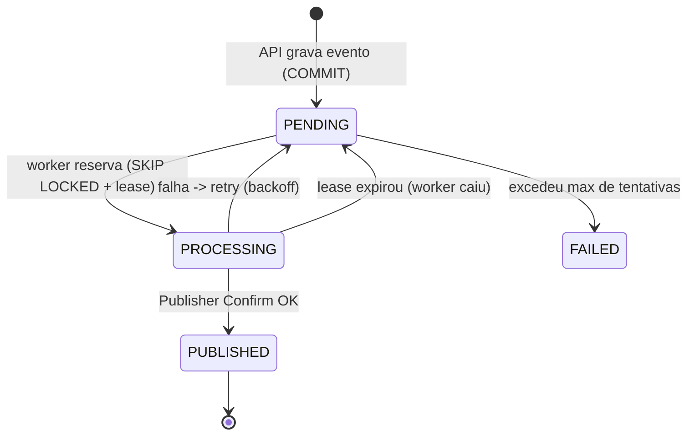

# Transactional Outbox Pattern — Demo (NestJS + PostgreSQL + RabbitMQ)

Projeto **didático** para demonstrar, em um meetup técnico, o funcionamento do
**Transactional Outbox Pattern**. O objetivo é tornar visível — pelo código,
pelo banco de dados e pelos logs — a jornada de um evento desde a criação do
pedido até sua publicação e processamento, incluindo cenários de falha e
recuperação.

> Projeto educacional. Cada componente existe para ajudar a entender o padrão,
> não para representar uma arquitetura corporativa completa.

---

## Sumário

- [O problema: Dual Write](#o-problema-dual-write)
- [A solução: Transactional Outbox](#a-solução-transactional-outbox)
- [Arquitetura](#arquitetura)
- [Responsabilidades dos serviços](#responsabilidades-dos-serviços)
- [Fluxo da transação (API)](#fluxo-da-transação-api)
- [Como o worker funciona](#como-o-worker-funciona)
- [Publicação no RabbitMQ](#publicação-no-rabbitmq)
- [Como o consumer funciona](#como-o-consumer-funciona)
- [Conceitos fundamentais](#conceitos-fundamentais)
- [Garantias e limitações](#garantias-e-limitações)
- [Instalação e execução](#instalação-e-execução)
- [Endpoints](#endpoints)
- [Consultas SQL úteis](#consultas-sql-úteis)
- [Comandos Docker Compose](#comandos-docker-compose)
- [Testes](#testes)
- [Estrutura do projeto](#estrutura-do-projeto)
- [Variáveis de ambiente](#variáveis-de-ambiente)

---

## O problema: Dual Write

Imagine o fluxo "ingênuo" de criar um pedido e avisar outros sistemas:

```ts
await db.insertOrder(order);        // 1) grava no banco
await broker.publish('OrderCreated'); // 2) publica no broker
```

Isso é um **dual write**: duas gravações em sistemas diferentes (banco e broker)
que **não compartilham a mesma transação**. Se o processo cair entre (1) e (2),
ou se o broker estiver indisponível, acontece uma inconsistência:

- O pedido existe no banco, mas **nenhum evento foi publicado** → outros
  sistemas nunca ficam sabendo do pedido.
- Ou, invertendo a ordem, o evento é publicado mas a transação do banco falha →
  evento publicado para um pedido que **não existe**.

Não há como tornar "gravar no banco" e "publicar no broker" **atômicos**, porque
são tecnologias distintas sem uma transação distribuída trivial.

## A solução: Transactional Outbox

A ideia central: **não publique direto no broker dentro da transação de
negócio**. Em vez disso, grave o evento em uma tabela (`outbox_events`) **na
mesma transação** do dado de negócio (`orders`).

```ts
await client.query('BEGIN');
await client.query('INSERT INTO orders ...');          // dado de negócio
await client.query('INSERT INTO outbox_events ...');   // evento, MESMA transação
await client.query('COMMIT');                           // atômico: ambos ou nenhum
```

Agora pedido e evento são confirmados **juntos** (um único COMMIT). Depois, um
**worker independente** lê a tabela Outbox e publica os eventos no broker, com
retry e confirmação. Se o broker estiver fora, o evento simplesmente aguarda na
tabela até ser publicado — sem perder nada.

---

## Arquitetura

```mermaid
flowchart LR
    Client([Cliente HTTP]) -->|POST /orders| API[API NestJS]

    subgraph PG[(PostgreSQL)]
        Orders[(orders)]
        Outbox[(outbox_events)]
        Processed[(processed_events)]
    end

    API -->|BEGIN / INSERT orders + outbox / COMMIT| PG

    Worker[Outbox Worker] -->|1. SKIP LOCKED: reserva PENDING| Outbox
    Worker -->|2. publish + Publisher Confirm| RMQ{{RabbitMQ\nexchange direct}}
    Worker -->|3. marca PUBLISHED| Outbox

    RMQ -->|fila durável| Consumer[Consumer]
    Consumer -->|INSERT ON CONFLICT DO NOTHING| Processed

    style API fill:#e3f2fd
    style Worker fill:#fff3e0
    style Consumer fill:#e8f5e9
    style RMQ fill:#fce4ec
```

Fluxo de estados de um evento na Outbox:



---

## Responsabilidades dos serviços

| Serviço | Tem HTTP? | Publica no broker? | Responsabilidade |
|---|---|---|---|
| **API** | Sim (porta 8080) | **Não** | Receber requisições, validar, executar a transação `orders` + `outbox_events`. |
| **Worker** | Não | **Sim** | Ler a Outbox, reservar eventos, publicar com Publisher Confirms, aplicar retry e recuperar reservas expiradas. |
| **Consumer** | Não | Não (consome) | Consumir a fila, processar de forma idempotente, confirmar (ACK manual). |

A separação é proposital: **a API não depende do RabbitMQ**. Mesmo com o broker
fora do ar, pedidos continuam sendo criados; os eventos ficam `PENDING` e são
publicados quando o broker voltar.

---

## Fluxo da transação (API)

O método `OrdersService.createOrder` é o trecho mais importante do projeto
(`apps/api/src/orders/orders.service.ts`):

```ts
const client = await this.db.getClient();
try {
  await client.query('BEGIN');

  // 1) Persiste o pedido
  await client.query('INSERT INTO orders (...) VALUES (...)', [...]);

  // (ponto de simulação de falha — Cenário 3)

  // 2) Persiste o evento na MESMA transação
  await client.query('INSERT INTO outbox_events (...) VALUES (...)', [...]);

  await client.query('COMMIT');   // atômico: pedido + evento juntos
} catch (error) {
  await client.query('ROLLBACK'); // falhou? nada é persistido
  throw error;
} finally {
  client.release();               // devolve a conexão ao pool
}
```

Pontos-chave:

- Controle de transação **explícito** (sem ORM escondendo o SQL).
- O `event_id` gerado aqui é **imutável** e será o `messageId` no RabbitMQ.
- A API **não** publica nada no broker.

---

## Como o worker funciona

Arquivos: `apps/worker/src/outbox/outbox.processor.ts` e `outbox.repository.ts`.

A cada ciclo de polling (padrão: 2s), o worker:

1. **Recupera reservas expiradas** (`recoverExpiredLeases`): eventos `PROCESSING`
   cujo `locked_until` já passou voltam para `PENDING` (worker anterior caiu).
2. **Reserva um lote** (`reserveBatch`) em uma **transação curta**:
   ```sql
   SELECT id FROM outbox_events
    WHERE status = 'PENDING' AND next_attempt_at <= now()
    ORDER BY created_at
    FOR UPDATE SKIP LOCKED      -- não disputa linhas com outros workers
    LIMIT $batch;
   -- e então UPDATE para PROCESSING, attempts+1, locked_until = now()+lease
   ```
3. Para cada evento, **publica no RabbitMQ e aguarda o Publisher Confirm**.
4. Em sucesso → `markPublished` (status `PUBLISHED`). Em falha → retry com
   **backoff exponencial** ou `FAILED` ao exceder o máximo de tentativas.

Detalhes importantes:

- **Nunca** mantemos transação do PostgreSQL aberta durante a comunicação com o
  RabbitMQ. A reserva é uma transação; a publicação acontece fora dela.
- Uma flag `running` impede **execuções de polling sobrepostas** na mesma
  instância.
- `FOR UPDATE SKIP LOCKED` permite rodar **vários workers** sem contenção: cada
  um pega linhas diferentes.
- O **lease** (`locked_until`) garante que, se um worker morrer no meio, o evento
  não fica preso para sempre — ele é recuperado após a expiração.

---

## Publicação no RabbitMQ

Arquivo: `libs/common/src/messaging/rabbitmq-publisher.service.ts`.

- Exchange **direct** e **durável**; fila **durável**; mensagens **persistentes**.
- **Publisher Confirms** via `ConfirmChannel`: um evento só é considerado
  publicado **após o broker confirmar** (ack). Enquanto não confirma, não
  marcamos `PUBLISHED`.
- `mandatory: true` + tratamento do evento `return`: detecta mensagens **não
  roteáveis** (sem fila de destino) e as trata como falha.
- `messageId = event_id`: o mesmo ID em todas as tentativas, usado pelo consumer
  como chave de idempotência.
- **Reconexão automática** quando o broker cai e volta.

Envelope do evento:

```json
{
  "event_id": "uuid",
  "event_type": "OrderCreated",
  "occurred_at": "2026-10-26T12:00:00Z",
  "data": { "order_id": "uuid", "customer_name": "Joao", "amount": 150.00 }
}
```

---

## Como o consumer funciona

Arquivos: `apps/consumer/src/consumer/order.consumer.ts` e
`processed-events.service.ts`.

- Consome a fila com **ACK manual** (`noAck: false`) e `prefetch` configurável.
- Para cada mensagem:
  1. Tenta registrar o `event_id` em `processed_events` com
     `INSERT ... ON CONFLICT DO NOTHING`.
  2. Se **inseriu** (novo) → processa o efeito de negócio e dá **ack**.
  3. Se **já existia** (duplicado) → loga `duplicate_detected` e dá **ack** (a
     mensagem já cumpriu seu papel), **sem** reprocessar.
  4. Em erro de processamento → `nack` com requeue (tentará de novo).
- O **ack só acontece após persistir** o processamento. Isso garante que, se o
  consumer cair antes de confirmar, a mensagem volta para a fila
  (at-least-once).

O registro em `processed_events` **é** o efeito de negócio observável da demo.

---

## Conceitos fundamentais

- **Atomicidade**: pedido e evento são gravados no mesmo COMMIT. Ou ambos, ou
  nenhum. É isso que elimina o dual write.
- **Consistência eventual**: o evento não é publicado no mesmo instante do
  COMMIT; o worker o publica logo depois. O sistema fica consistente "em algum
  momento", não instantaneamente.
- **At-least-once delivery**: o padrão garante que cada evento será entregue
  **pelo menos uma vez**. Duplicatas são possíveis (ex.: crash após o confirm,
  antes de marcar `PUBLISHED`).
- **Idempotência**: como pode haver duplicatas, o consumer precisa ser
  idempotente. A tabela `processed_events` com `event_id` único resolve isso.
- **Polling**: o worker consulta a Outbox periodicamente. Simples e suficiente
  para a demonstração (alternativas: LISTEN/NOTIFY, CDC).
- **Publisher Confirms**: confirmação do broker de que a mensagem foi aceita.
  Sem isso, não há como saber se a publicação funcionou.
- **Retry e recuperação**: falhas transitórias são reprocessadas com backoff;
  workers interrompidos têm seus eventos recuperados via lease.

---

## Garantias e limitações

**O padrão garante:**

- Nenhum evento é perdido: se o COMMIT ocorreu, o evento existe e será publicado.
- A publicação não acontece sem o dado de negócio ter sido persistido.
- Entrega **pelo menos uma vez** ao consumer.

**Continua sendo responsabilidade da aplicação:**

- **Idempotência no consumer** (duplicatas vão acontecer).
- **Ordenação**: esta demo não garante ordem global de eventos.
- **Tamanho da Outbox**: em produção, é preciso arquivar/limpar eventos
  `PUBLISHED` antigos.
- **Monitorar `FAILED`**: eventos que excederam as tentativas exigem ação
  (reprocessamento manual — ver `scripts/demo/reprocess-failed.sh`).

---

## Instalação e execução

Pré-requisitos: **Docker** e **Docker Compose**. (Para rodar fora do Docker:
Node.js 22 LTS.)

Subir tudo:

```bash
docker compose up --build -d
```

Acompanhar os logs (recomendado durante a demo):

```bash
docker compose logs -f api worker consumer
```

Serviços e credenciais locais:

| Serviço | Endereço | Usuário / Senha |
|---|---|---|
| API | http://localhost:8080 | — |
| RabbitMQ Management | http://localhost:15672 | guest / guest |
| PostgreSQL | localhost:5432 (configurável) | postgres / postgres (db: `outbox`) |

Parar tudo:

```bash
docker compose down          # mantém volumes
docker compose down -v       # remove volumes (zera dados)
```

---

## Endpoints

### `POST /orders`

```bash
curl -X POST http://localhost:8080/orders \
  -H "Content-Type: application/json" \
  -d '{"customer_name":"Joao","amount":150.00}'
```

Resposta `201`:

```json
{ "id": "uuid", "status": "CREATED" }
```

### `GET /orders/:id`

Retorna os dados de um pedido.

### `GET /health`

```json
{ "status": "ok", "postgres": "up" }
```

---

## Consultas SQL úteis

Há um atalho pronto: `./scripts/demo/inspect.sh`.

```bash
# Pedidos
docker compose exec postgres psql -U postgres -d outbox -c \
  "SELECT id, customer_name, amount, status, created_at FROM orders ORDER BY created_at DESC;"

# Eventos da Outbox (o mais importante para acompanhar)
docker compose exec postgres psql -U postgres -d outbox -c \
  "SELECT id, event_type, status, attempts, next_attempt_at, locked_until, last_error FROM outbox_events ORDER BY created_at DESC;"

# Idempotência (efeito de negócio do consumer)
docker compose exec postgres psql -U postgres -d outbox -c \
  "SELECT event_id, processed_at FROM processed_events ORDER BY processed_at DESC;"

# Resumo por status
docker compose exec postgres psql -U postgres -d outbox -c \
  "SELECT status, count(*) FROM outbox_events GROUP BY status;"
```

---

## Comandos Docker Compose

```bash
docker compose up --build -d          # sobe tudo
docker compose logs -f api worker consumer
docker compose ps                     # status dos serviços
docker compose stop rabbitmq          # simula broker fora do ar
docker compose start rabbitmq         # restaura o broker
docker compose restart worker         # reinicia o worker
docker compose down -v                # derruba e zera os dados
```

---

## Testes

```bash
# Testes unitários (não exigem infraestrutura)
npm test

# Testes de integração (exigem o PostgreSQL do compose no ar)
docker compose up -d postgres
npm test                              # os testes de integração passam a rodar

# Cobertura
npm run test:cov
```

Cobertura dos testes:

- **Transação única** (API): pedido + evento no mesmo COMMIT.
- **ROLLBACK**: erro após o pedido não deixa dados isolados.
- **Reserva / SKIP LOCKED** (integração): seleção de eventos pendentes.
- **Publisher Confirms**: só resolve após o ack do broker; rejeita nack/não
  roteável.
- **Retry com backoff** e transição para **FAILED**.
- **Recuperação de lease expirado** (integração).
- **Idempotência** do consumer (`ON CONFLICT DO NOTHING`).

> Os testes de integração **pulam automaticamente** (com aviso) quando o
> PostgreSQL não está acessível, para não quebrar a suíte em ambientes sem infra.

---

## Estrutura do projeto

```text
.
├── apps/
│   ├── api/        # API HTTP (OrdersController, OrdersService, Health)
│   ├── worker/     # Outbox Worker (OutboxProcessor, OutboxRepository)
│   └── consumer/   # Consumer (OrderConsumer, ProcessedEventsService)
├── libs/
│   └── common/     # config, database (pg), messaging (amqplib), logging (pino)
├── migrations/
│   └── 001_init.sql
├── scripts/
│   └── demo/       # inspect.sh, reprocess-failed.sh
├── Dockerfile      # multi-stage; ARG APP escolhe o entrypoint
├── docker-compose.yml
├── .env.example
├── README.md
└── DEMO.md         # roteiro de apresentação ao vivo
```

---

## Variáveis de ambiente

Veja `.env.example` para a lista completa. Destaques:

| Variável | Padrão | Descrição |
|---|---|---|
| `POSTGRES_PORT` | `5432` | Porta externa do PostgreSQL. |
| `OUTBOX_POLLING_INTERVAL_MS` | `2000` | Intervalo de polling do worker. |
| `OUTBOX_LEASE_DURATION_MS` | `30000` | Duração da reserva (lease). |
| `OUTBOX_MAX_ATTEMPTS` | `5` | Tentativas antes de `FAILED`. |
| `OUTBOX_RETRY_BACKOFF_BASE_MS` | `2000` | Base do backoff exponencial. |
| `CONSUMER_PREFETCH` | `1` | Prefetch do consumer. |
| `LOG_LEVEL` | `info` | Nível dos logs. |
| `LOG_PRETTY` | `false` | `true` para logs legíveis (pino-pretty). |
| `SIMULATE_API_FAILURE` | `false` | Cenário 3: força ROLLBACK na API. |
| `SIMULATE_CRASH_AFTER_CONFIRM` | `false` | Cenário 4: derruba o worker após o confirm. |

---

Para o roteiro de apresentação passo a passo (code review + demonstrações de
falha e recuperação), veja **[DEMO.md](./DEMO.md)**.
